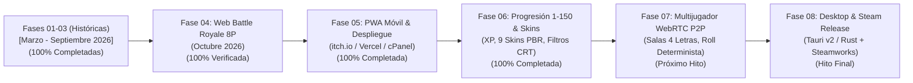

# 🎲 AGALLUDO ROYALE · 3D GEOMETRIC BATTLE ROYALE
### *El clásico juego de dados transformado en un frenético Battle Royale físico de 8 jugadores*

[](https://github.com/DOMINUSBABEL/AGALLUDO)
[](https://github.com/DOMINUSBABEL/AGALLUDO)
[](https://github.com/DOMINUSBABEL/AGALLUDO)
[](https://babylonias.com/agalludo/)
[](https://github.com/DOMINUSBABEL)

---

## ⚡ Enlace Directo a Demo Jugable en Producción
Juega de inmediato en el navegador sin descargas ni instalación previa:
👉 **[https://babylonias.com/agalludo/](https://babylonias.com/agalludo/)**

---

## 📖 Visión General del Proyecto

**Agalludo Royale** es la evolución competitiva y matemática del tradicional juego latinoamericano *"El Agalludo"* (también conocido como *Diez Mil*, *Greed* o *Farkle*).

El dilema vertebral del juego es la **gestión de la codicia y el riesgo**:
* Cada tirada exitosa acumula puntos temporales en el casillero de turno.
* **1 Mortal:** Sacar un 1 pulveriza el acumulado a cero (*Bust*) y expulsa al jugador a una penalización de stasis temporal.
* **El Dilema:** El jugador debe decidir estratégicamente en qué momento detenerse y pulsar **ASEGURAR (BANK)** para blindar sus puntos permanentemente antes de ser eliminado por el foso o los dados rivales.

---

## 🌟 Características Principales (Fase 1 Web Curada)

### 1. ⚔️ Caos Físico de 8 Dados Simultáneos
* **8 Bahías Perimétricas Octogonales:** Lanzamientos concurrentes de 4 a 8 competidores al mismo tiempo.
* **Colisiones Reales en 3D:** Los dados chocan elásticamente entre sí en el centro de la arena, alterando trayectorias, modificando caras en reposo y expulsando a los rivales hacia la fosa abisal.

### 2. 🎛️ 5 Tableros / Arenas con Físicas Desacopladas
Cada mesa cuenta con propiedades dinámicas independientes de Cannon.js y shaders personalizados:
1. **Salón de Roble (Burdeos):** Fieltro equilibrado (Fricción $0.65$, Restitución $0.48$).
2. **Verde Casino (Montecarlo):** Fieltro pesado de alta fricción ($0.85$) para tiros controlados.
3. **Búnker Industrial (Acero):** Alta restitución metálica ($0.65$) y chispas de colisión láser.
4. **Tribunal de Mármol (Carrara):** Superficie hiperbólica ultra-resbaladiza ($0.12$).
5. **Casino Virtual (Plasma):** Microgravedad ($-8.0\text{ m/s}^2$) con suspensión gravitacional.

### 3. 💥 Arsenal Táctico de 4 Poderes en Tiempo Real
* 💥 **Freno Magnético `[Espacio]`:** Congela instantáneamente la rotación y avance del dado para asegurar caras de valor 5 o 6.
* 🛡️ **Escudo de Fosa `[C]`:** Absorbe el impacto de un 1 Mortal y asegura automáticamente todo el acumulado en curso.
* ⚡ **Onda de Choque Repulsora `[X]`:** Desata un pulso cinético radial que dispersa y repele a los dados rivales fuera de la mesa.
* 🧲 **Vórtice Táctico `[V]`:** Genera un pozo de gravedad central durante 2.5 segundos arrastrando a todos los dados hacia una colisión masiva.

### 4. 📱 Controles Slingshot Táctiles & PWA 100% Offline
* **Lanzamiento Slingshot:** Tensa hacia atrás con el dedo o ratón para apuntar con guía de trayectoria parabólica y suelta para lanzar con impulso proporcional.
* **Feedback Háptico:** Vibración nativa en dispositivos móviles al tensar y soltar tiros.
* **PWA Instalable:** Service Worker (`sw.js`) con estrategia Cache-First y `manifest.json`. Funciona 100% en Modo Avión sin conexión a internet.

### 5. 🏆 Meta-Progresión de Niveles 1 al 150 & 9 Skins PBR
* **Curva de XP Exponencial:** Gana experiencia por puntos bancados, rivales expulsados y victorias de torneo.
* **9 Skins Procedurales en Canvas en Memoria:** Marfil Pulido, Ámbar Casino, Oro de Montecarlo, Carbono Ébano, Zafiro Neón, Rubí Casino, Espejo Cromo, Esmeralda Fosa y Materia Amatista.
* **Filtros CRT Retro:** Fósforo Verde, Ámbar de Seguridad, Carmesí Industrial y Cero Distorsión.

---

## 🏗️ Arquitectura del Sistema

```
┌─────────────────────────────────────────────────────────────────────────────────┐
│                           AGALLUDO ROYALE CLIENT CORE                           │
├──────────────────────────────────────┬──────────────────────────────────────────┤
│         Renderizado 3D PBR           │          Simulación Física 3D            │
│         Three.js r128                │          Cannon.js 0.6.2                 │
├──────────────────────────────────────┼──────────────────────────────────────────┤
│         Audio Procedural             │          Meta-Progresión & PWA           │
│         Web Audio API (Sintetizador) │          Service Worker + LocalStorage   │
└──────────────────────────────────────┴──────────────────────────────────────────┘
                                       │
        ┌──────────────────────────────┼──────────────────────────────┐
        ▼                              ▼                              ▼
Producción Web (BABYLON.IA)       PWA Móvil Touch               Steam / Desktop
(https://babylonias.com/)       (Android & iOS Offline)        (Tauri v2 / Rust)
```

---

## 📊 Linaje Forense y Cronología Histórica Certificada

| Fecha | Hito / Versión | Descripción y Tecnologías |
|---|---|---|
| **22/03/2026** | `v0.1-mobile-aether` | Primeros prototipos móviles conceptuales en Android (`Aether.apk`) e iOS (`Aether.ipa`). |
| **03/06/2026** | `v0.3-android-compose` | Repositorio formal nativo en Kotlin y Jetpack Compose con 3 personalidades de bot. |
| **20/06/2026** | `v0.5-electron-web` | Migración WebGL 3D, ejecutable Desktop Electron (176.8 MB) y Android APK v1.0. |
| **19/09/2026** | `v0.9-unity-urp` | Prototipo Standalone en Unity 6 con Universal Render Pipeline (URP) y post-procesamiento HDR. |
| **23/09/2026** | `v1.0-web-deploy` | Exportación WebGL autónoma distribuida en hosting cPanel de Babylon.IA. |
| **12/10/2026** | **`v1.5.0-BR8`** | **Versión Curada Battle Royale 8P Web, 5 arenas, 4 poderes, PWA offline y controles Slingshot.** |

---

## 🗺️ Roadmap de Desarrollo Interactivo (Voidfront)

El proyecto cuenta con un dashboard de gobernanza agéntica interactivo:
* **Dashboard HTML:** [`docs/roadmap.html`](docs/roadmap.html) *(abrir en navegador)*.
* **Ledger Estructurado:** [`docs/roadmap.json`](docs/roadmap.json).
* **Documento de Diseño Maestro:** [`docs/GDD_AGALLUDO_ROYALE.md`](docs/GDD_AGALLUDO_ROYALE.md).
* **Auditoría Forense Completa:** [`docs/AUDITORIA_CURACION.md`](docs/AUDITORIA_CURACION.md).



---

## 🚀 Ejecución Local

Para ejecutar el juego localmente:

```bash
# Clonar el repositorio
git clone https://github.com/DOMINUSBABEL/AGALLUDO.git
cd AGALLUDO

# Ejecutar el servidor ligero de pruebas
python scripts/run_server.py
```
Abre en tu navegador: **`http://localhost:8092/`**

Para ejecutar las pruebas automatizadas E2E en Chrome Headless:
```bash
python scripts/verify_web_e2e.py
```

---

## 👨‍💻 Autor & Arquitectura
* **Desarrollador:** DOMINUSBABEL / Juan Esteban Gómez Bernal
* **Ecosistema:** [BABYLON.IA](https://babylonias.com/) · Antigravity AI Agentic Architecture
* **Contacto:** `DOMINUSBABEL@babylonias.com`
