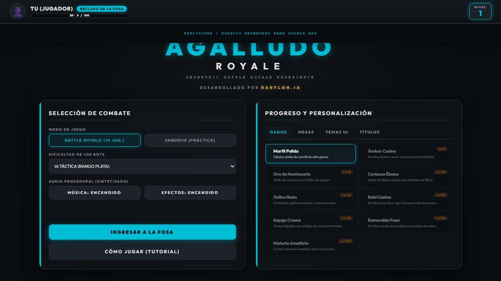
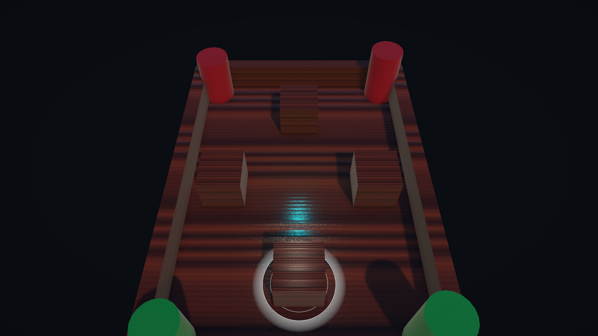
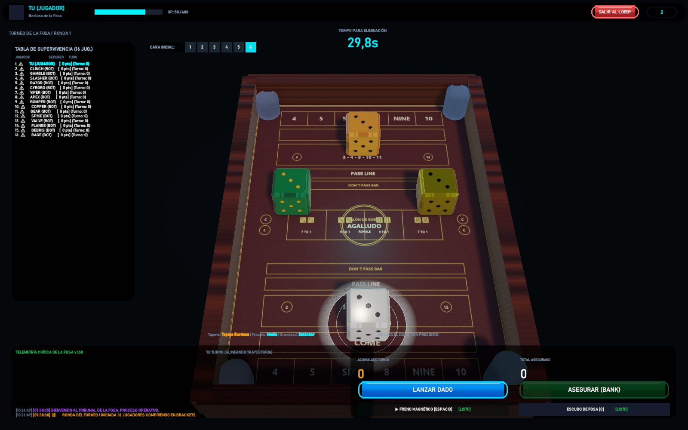
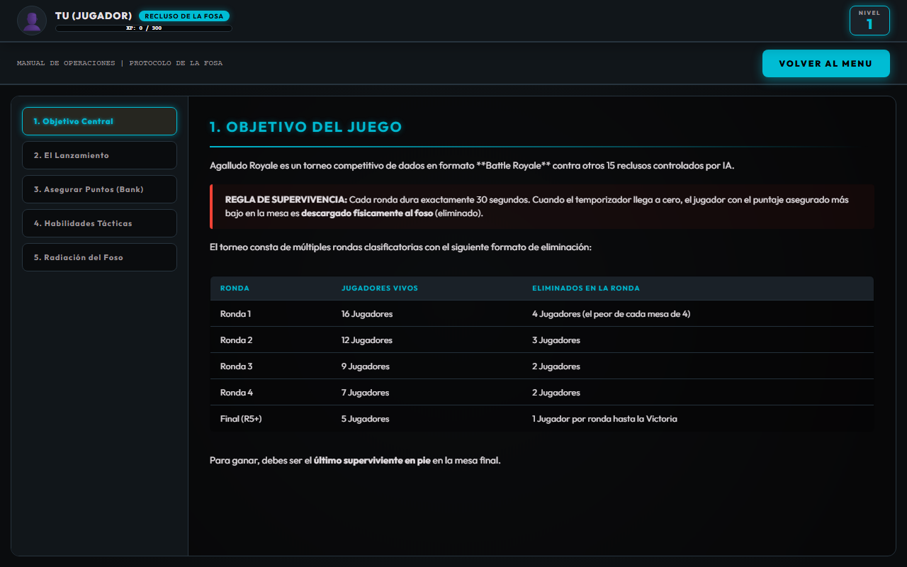
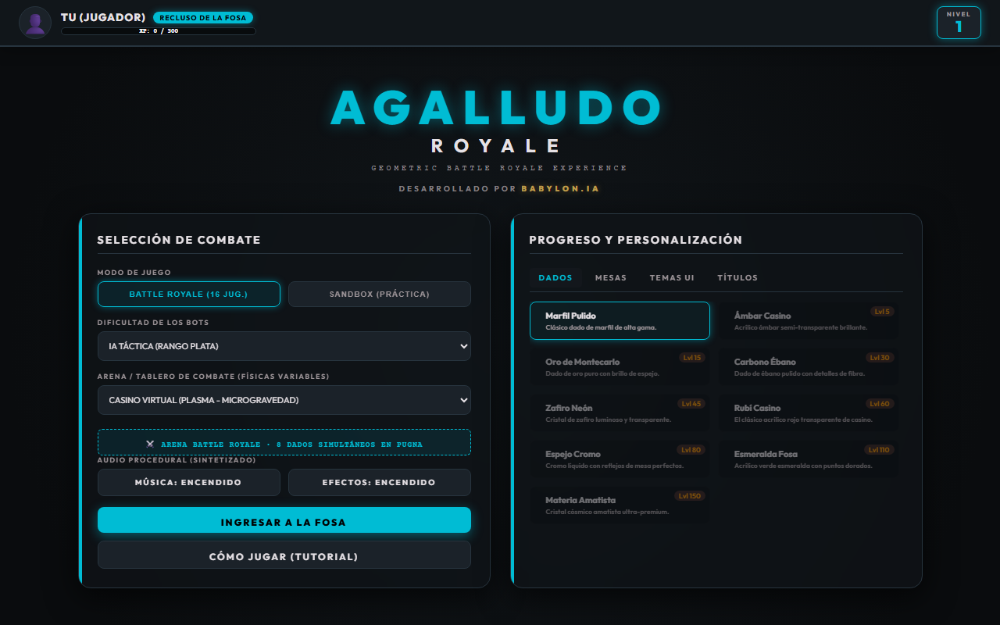
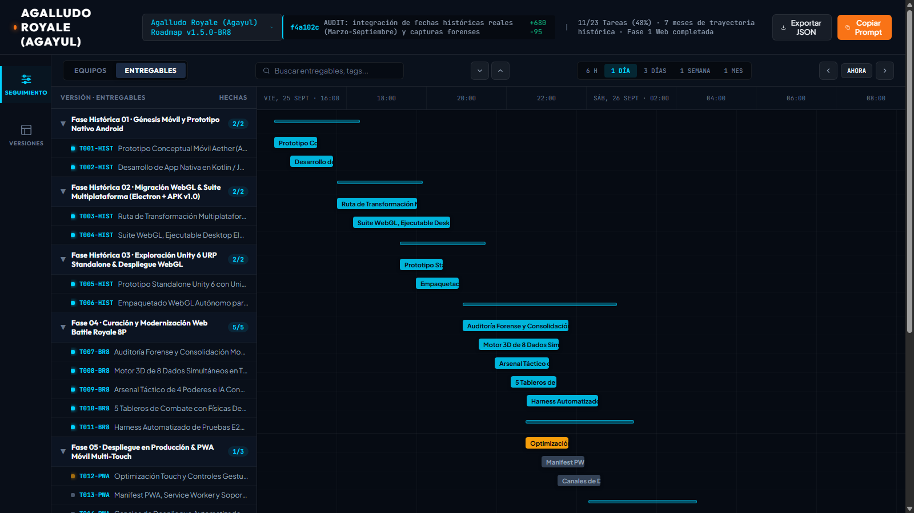
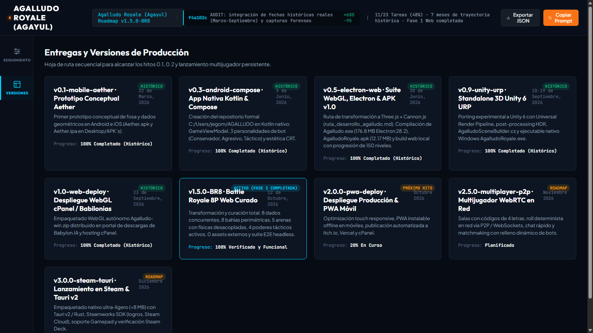
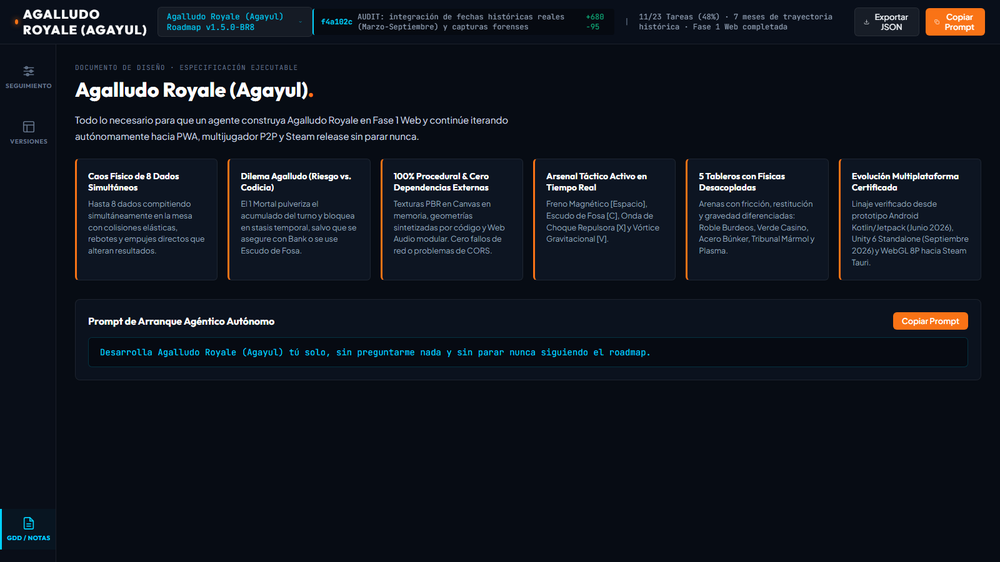

# AUDITORÍA TÉCNICA, CRONOLOGÍA FORENSE Y ROADMAP INTEGRAL: PROYECTO AGAYUL (AGALLUDO ROYALE)
**Ecosistema de Desarrollo Agéntico · BABYLON.IA / Antigravity**  
**Fecha de Auditoría:** 12 de Octubre de 2026 | **Versión Activa:** 1.5.0-BR8

---

## 1. Contexto Histórico y Origen del Proyecto ("Agayul")

El término **"Agayul"** corresponde a la denominación fonética, interna y coloquial de **"El Agalludo"** (conocido culturalmente en Colombia y Latinoamérica como *Diez Mil*, *Greed* o *Farkle*). El núcleo lúdico radica en el **dilema del riesgo y la codicia**:
- El jugador lanza dados para sumar acumulado temporal (*Acumulado Turno*).
- Puede volver a lanzar indefinidamente arriesgando su racha.
- **Riesgo Letal (1 Mortal):** Sacar un 1 pulveriza el acumulado a cero (*Bust*) y aplica un bloqueo de turno (*Stasis*).
- **El Dilema:** El jugador debe decidir cuándo frenar y presionar **ASEGURAR (BANK)** para blindar sus puntos en la fosa.

El proyecto cuenta con más de **7 meses de desarrollo documentado y verificable en disco**, evolucionando a través de 5 hitos tecnológicos clave antes de la presente consolidación en Web Battle Royale 8P.

---

## 2. Cronología Forense de Versiones y Artefactos en Disco

Tras una inspección bit a bit en los directorios del usuario, se identificaron y verificaron las siguientes versiones históricas con fechas de creación inalteradas:

| Fecha Real | Versión / Hito | Tecnología | Artefacto en Disco | Tamaño / Hash | Estado |
|---|---|---|---|---|---|
| **22/03/2026** | `v0.1-mobile-aether` | Mobile Nativo | `OneDrive\Desktop\APK´s\AGALLUDO\Aether.apk` `Aether.ipa` | 4.27 MB (APK) 4.41 MB (IPA) | Histórico Preservado |
| **03/06/2026 09:16** | `v0.3-android-compose` | Android Nativo (Kotlin) | `C:\Users\jegom\AGALLUDO\app\src\main\` (`AgalludoModels.kt`, `DicePhysics.kt`) | ~18 MB (Src) Jetpack Compose | Histórico Preservado |
| **20/06/2026 09:31** | *GDD Multiplataforma* | Arquitectura WebGL | `antigravity-cli\...\ruta_desarrollo_agalludo.md` | 11.6 KB (Markdown) | Histórico Preservado |
| **20/06/2026 16:50** | `v0.5-electron-web` | Electron 28.2 / WebGL | `OneDrive\Desktop\APK´s\Nueva carpeta\Ejecutable\Agalludo.exe` `Android\AgalludoRoyale.apk` `Web\index.html` | 176.8 MB (EXE) 12.17 MB (APK) WebGL Three.js 0.160 | Histórico Preservado |
| **03/09/2026 09:25** | `v0.7-apk-release` | Android Nativo | `C:\Users\jegom\AGALLUDO\AGALLUDO-Royale-v1.0.apk` | 12.17 MB (APK) | Histórico Preservado |
| **18-19/09/2026** | `v0.9-unity-urp` | Unity 6 URP Standalone | `scratch\AgalludoRoyale_Unity\Builds\Windows\AgalludoRoyale.exe` `AgalludoSceneBuilder.cs` | Standalone Win64 Post-Process URP | Histórico Preservado |
| **23/09/2026** | `v1.0-web-deploy` | WebGL Producción | `babylonias_web_deploy\downloads\Agalludo-win.zip` | 42.1 MB (ZIP) | Histórico Preservado |
| **12/10/2026 (HOY)** | `v1.5.0-BR8` | Three.js + Cannon 8P | `scratch\agalludo_royale\web\` (`index.html`, `renderer.js`) | Cero dependencias externas · 8P BR | **Completado & Verificado** |

---

## 3. Galería de Evidencias Visuales por Versión

Todas las capturas han sido extraídas, ejecutadas y consolidadas en `docs/gdd/evidencia/`:

### A. Versiones Históricas (Junio - Septiembre 2026)
1. **Menú Suite WebGL / Electron (20 de Junio, 2026):**  
     
   *Muestra el selector de modo (16 jugadores / Sandbox), IA novata/táctica/maestra, progresión de niveles 1 a 150 y selector de dados.*

2. **Gameplay Físico 3D Legacy (20 de Junio, 2026):**  
     
   *Mesa 3D en Three.js con físicas Cannon.js tempranas.*

3. **Blockout 3D de Mesa en Unity 6 (19 de Septiembre, 2026 07:50 a.m.):**  
     
   *Escena procedural con postes guía perimétricos y dados de madera.*

4. **Gameplay Standalone Unity 6 URP (19 de Septiembre, 2026 10:26 a.m.):**  
     
   *Renderizado URP en tiempo real con iluminación volumétrica, temporizador de 29.8s y físicas C#.*

### B. Versión Curada Battle Royale 8P (12 de Octubre, 2026 - Fase 1)
5. **Lobby 8 Jugadores con Selector de 5 Arenas:**  
     
   *Selección entre Roble Burdeos, Verde Casino, Acero Búnker, Tribunal Mármol y Casino Plasma.*

6. **Manual Visual de los 4 Poderes Tácticos:**  
     
   *Freno Magnético `[Espacio]`, Escudo de Fosa `[C]`, Onda Repulsora `[X]` y Vórtice `[V]`.*

7. **Combate Activo de 8 Dados Concurrentes (Mesa Roble Burdeos):**  
     
   *8 dados rodando simultáneamente desde sus bahías perimétricas de 45° colisionando en el centro.*

8. **Combate en Arena Acero Búnker:**  
     
   *Alta restitución metálica y chispas de partículas.*

9. **Combate en Arena Virtual Plasma:**  
     
   *Gravedad reducida (-8.0 m/s²) con micro-flotación de dados.*

10. **Gantt Dashboard de Gobernanza Agéntica:**  
    

11. **Matriz de Entregas y Versiones de Producción:**  
    

12. **Documento de Diseño (GDD) y Pilares:**  
    

---

## 4. Matriz Comparativa: Auditado vs. Curado

| Componente | Estado Previo Auditado | Estado Curado v1.5.0-BR8 | Próximo Hito (v2.0 - v3.0) |
|---|---|---|---|
| **Número de Dados** | 4 fijos en cruz | **8 concurrentes** (bahías a 45°) | Brackets de 16 a 64 jugadores |
| **Concurrencia IA** | Estrictamente secuencial | **4 a 8 dados rodando a la vez** | Matchmaking P2P WebRTC |
| **Arenas y Físicas** | 1 superficie estática | **5 tableros con físicas desacopladas** | Arenas dinámicas con bumpers y pernos |
| **Arsenal Táctico** | Incompleto | **4 poderes dinámicos activos** | Cooldowns y mejoras por nivel |
| **Skins Cosméticas** | Parcialmente funcional | **Texturas procedurales en memoria Canvas** | 9 skins PBR por progresión |
| **Empaquetado** | Electron (176 MB) / APK nativa | **Web pura 0 assets externos** | PWA Offline + Tauri v2 (<8 MB) Steam |
| **Pruebas** | Manuales | **Harness Python Chrome Headless E2E** | CI/CD en GitHub Actions / Vercel |

---

## 5. Próximos Pasos del Master Roadmap

1. **Fase 05 (En curso):** Controles Slingshot táctiles para móviles y empaquetado PWA offline con despliegue en itch.io y Vercel.
2. **Fase 06:** Sistema completo de niveles 1 al 150, curva de XP persistente y desbloqueo de las 9 skins PBR.
3. **Fase 07:** Multijugador WebRTC en tiempo real con salas privadas y matchmaking con bots adaptativos.
4. **Fase 08:** Integración con Steamworks SDK, logros, guardado en nube y certificación para Steam Deck vía Tauri v2.
